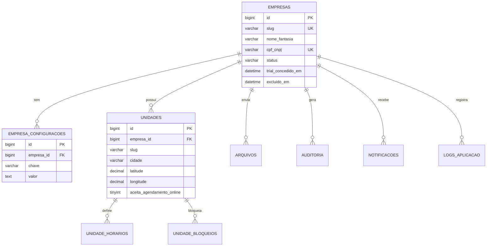
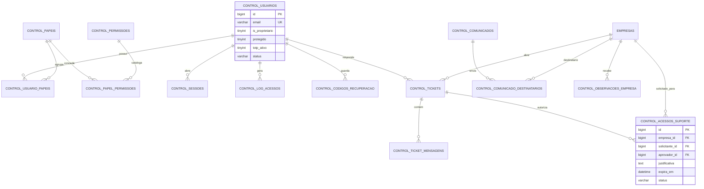
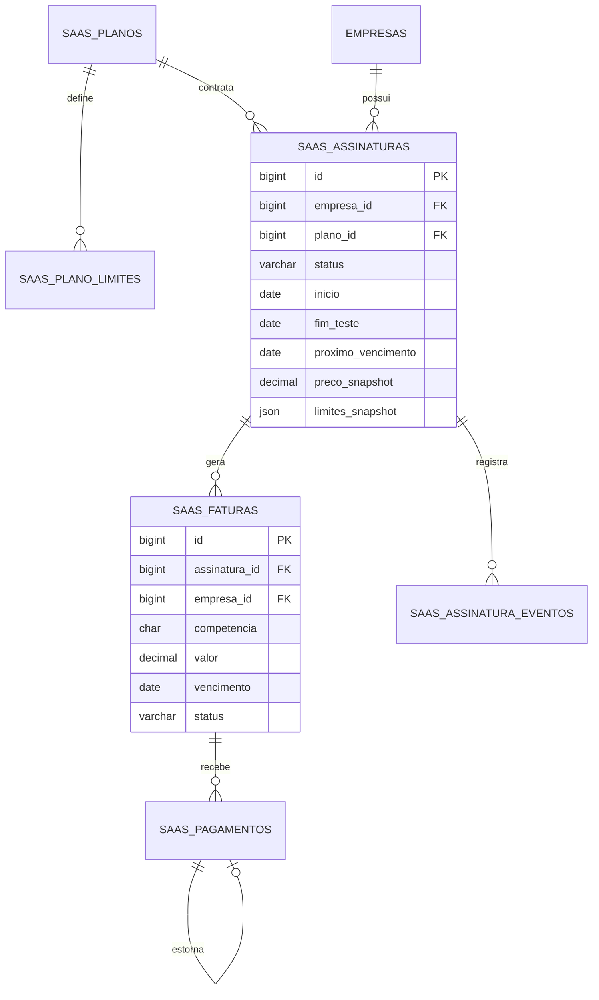
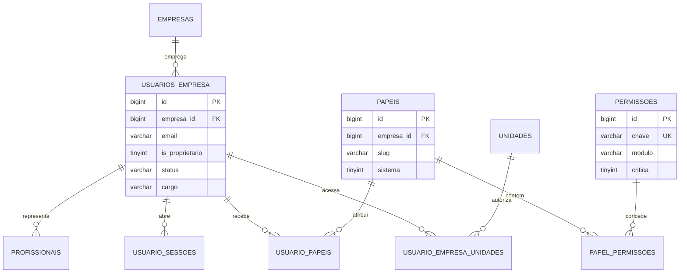
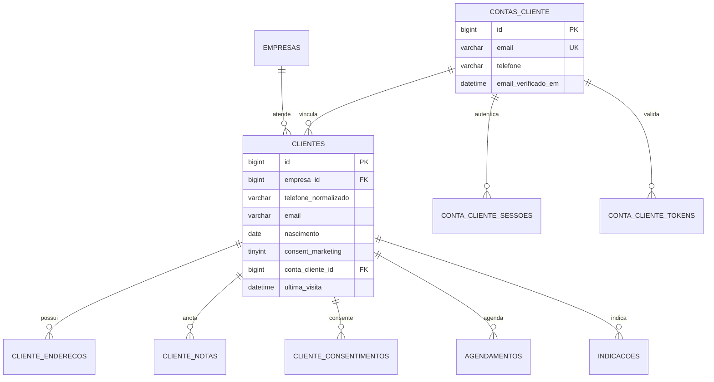
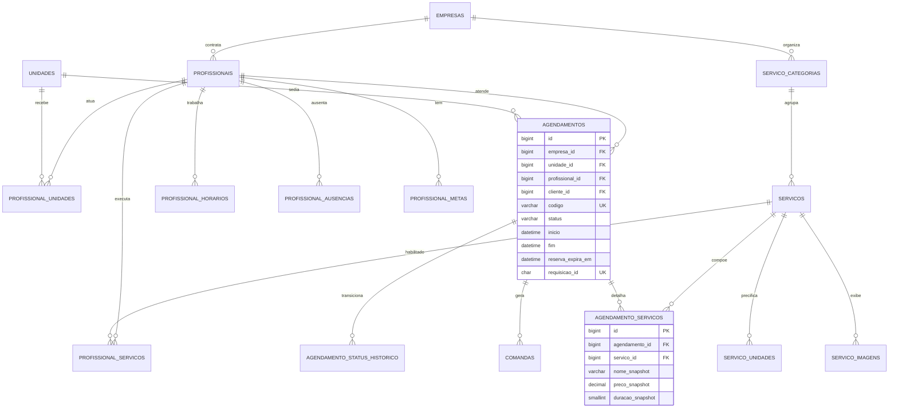
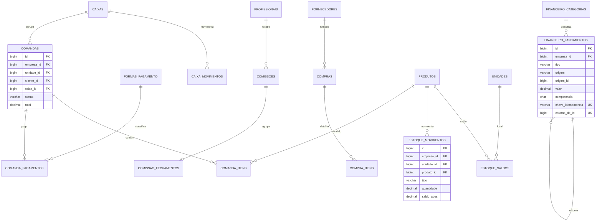
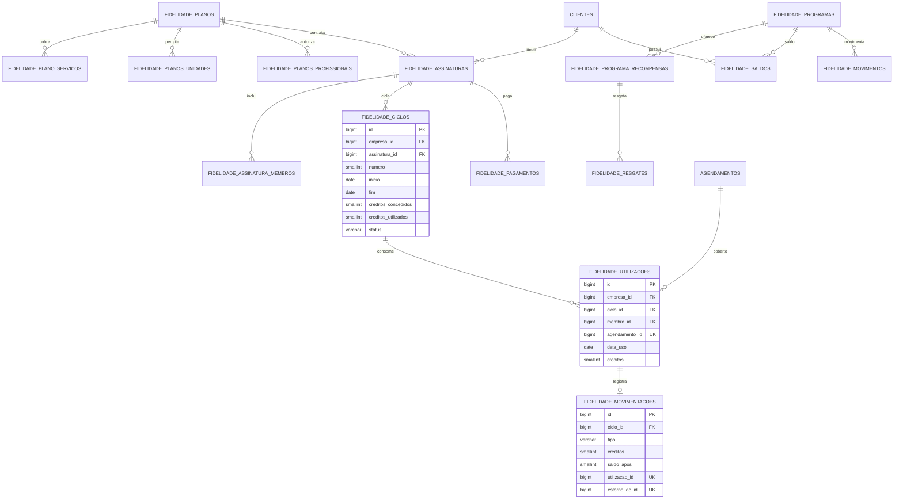
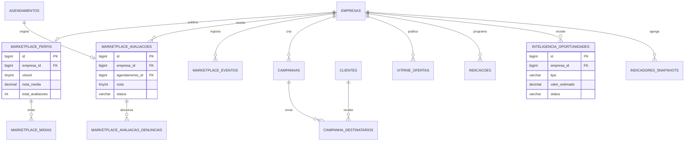

# 05 — Diagramas de Relacionamentos

Voltar ao [índice](00-INDICE.md) · Modelo detalhado em [04-BANCO-DE-DADOS.md](04-BANCO-DE-DADOS.md)

Diagramas por domínio (um diagrama único com 113 tabelas seria ilegível). As linhas mostram
**relacionamentos com FK**; colunas de ligação lógica sem FK aparecem indicadas.

---

## 1. Plataforma, empresas e unidades

---

## 2. Barberify Control (identidade global)

> `control_*` não possui `empresa_id` como coluna de tenant. O vínculo com empresa, quando existe
> (ticket, acesso de suporte, comunicado), é explícito e auditado.

---

## 3. SaaS (barbearia → Soluções AL)

---

## 4. Usuários da empresa, papéis e sessões

**UQ relevantes:** `(empresa_id, email)`, `(empresa_id, is_proprietario)`, `(empresa_id, slug)` em papéis,
`(usuario_id, papel_id)`, `(usuario_id, unidade_id)`.

---

## 5. Clientes, CRM e conta do consumidor

**Por que duas tabelas:** o cliente é **da empresa** (isolamento e histórico próprios); a conta é
**global e opcional**, criada só quando o consumidor quer ver tudo em um lugar. O vínculo
`clientes.conta_cliente_id` é registrado com consentimento em `cliente_consentimentos`, e cada empresa
continua enxergando apenas as próprias linhas.

---

## 6. Profissionais, catálogo e agenda

**Tabela de trava:** `agenda_bloqueios_concorrencia (profissional_id, data)` — PK composta, sem FK de
negócio, usada só para serializar a checagem de sobreposição.

---

## 7. Atendimento, financeiro e estoque

---

## 8. Fidelidade e assinaturas dos consumidores

**Invariante:** `saldo` do ciclo = soma de `creditos` em `fidelidade_movimentacoes` daquele ciclo.
Toda operação grava movimento + saldo na mesma transação; nenhum `UPDATE` altera movimento.

---

## 9. Marketplace, marketing e inteligência

---

## 10. Fronteiras que os diagramas tornam explícitas

| Fronteira | Garantia |
|---|---|
| `control_*` ↔ operação da barbearia | nenhuma FK direta; contato só por `control_acessos_suporte` autorizado |
| `saas_*` ↔ `fidelidade_*` | nenhuma FK, nenhum JOIN; tabelas, serviços e telas separados |
| `empresas` ↔ `clientes/serviços/agenda` | sempre com `empresa_id`, FK com `RESTRICT` |
| `contas_cliente` ↔ `clientes` | vínculo opcional (`SET NULL`) e consentido |
| Ledger ↔ operação | ledger nunca é atualizado; operação referencia o lançamento |
